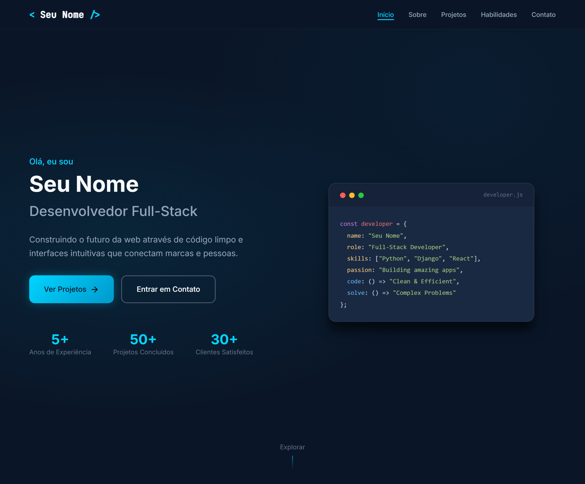

# 🌊 Portfólio Dinâmico com Django | Template Educativo para Portfólios

**Português (Brasil)** · [English](README.en.md)


[](https://github.com/ryanvmorais/django-fullstack-portfolio/actions/workflows/ci.yml)


🔗 **[Ver demo ao vivo](https://djangofullstackportfolio.pythonanywhere.com/)**

Este repositório contém um **Portfólio Dinâmico com Django**, um portfólio profissional criado como template educativo. Embora se apresente visualmente como uma *SPA* (Single Page Application), o projeto foi construído como um sistema robusto, focando em **segurança avançada**, **otimização de banco de dados** e **arquitetura limpa**.

### 🎯 Objetivo do Projeto:

Demonstrar a aplicação de **boas práticas profissionais** de desenvolvimento Web, indo além do "CRUD básico". O foco aqui é oferecer um exemplo real de uma aplicação pronta para a internet, ensinando como implementar proteções contra bots, evitar ataques comuns e otimizar a performance do banco de dados de forma simples e didática.

---

### 📚 O que você vai aprender com este projeto?

Este projeto foi estruturado para consolidar pilares fundamentais de engenharia de software:

- **Segurança Ofensiva e Defensiva:** implementação de *Honeypot* (armadilha para bots), *Rate Limit* (limitação de envios por IP) e integração com `bleach` para sanitização de HTML.
- **Performance & Escala:** uso de `select_related` e `prefetch_related` para mitigar o problema de consultas N+1, garantindo carregamento instantâneo.
- **DevOps Mindset:** dependências travadas num `uv.lock` (runtime, grupo `dev` e extra `prod`) com quarentena de 7 dias contra versões recém-publicadas, `pip-audit` no CI e toda segunda-feira, Dependabot, além de configurações rigorosas de CSP (Content Security Policy) e HSTS.
- **Interface Auditada:** a home foi conferida em Chrome real (10 tamanhos de celular, axe-core, teclado, formulário) e corrigida com um teste por requisito: hero que cabe na primeira tela do celular, formulário que avisa o visitante em qualquer resposta do servidor, menu acessível, contraste, "reduzir movimento", fontes hospedadas no projeto e páginas de erro próprias (spec 004).
- **Qualidade de Código:** suíte de testes automatizados com `pytest` cobrindo fluxos de sucesso e tentativas de ataque.

---

### 🧠 Guia de Implementação (A Lógica por trás do Código):

Para quem está começando, o maior desafio não é decorar comandos do Django, mas entender a **montagem do raciocínio** de uma aplicação profissional. Confira os pilares da construção deste projeto:

1. **Arquitetura de Dados Relacional:** em vez de textos soltos, utilizamos o **ORM do Django** para criar relacionamentos inteligentes. Por exemplo, um `Projeto` está ligado a uma `Categoria` e a várias `Tecnologias`. Isso permite que o banco de dados trabalhe por você, facilitando filtros e buscas.
2. **Otimização de Consultas (Performance):** para evitar que o site fique lento, usamos um "truque sênior": o `select_related` e o `prefetch_related`. Eles reduzem o número de idas ao banco de dados, buscando todas as informações necessárias em uma única viagem, o que é crucial para manter a **Alta Performance**.
3. **Segurança Defensiva (Honeypot):** para proteger o formulário de contato sem usar CAPTCHAs chatos, criamos uma "armadilha invisível". É um campo oculto que humanos não veem, mas robôs preenchem automaticamente. Se o campo for preenchido, o sistema identifica o bot e descarta o envio silenciosamente.
4. **Controle de Fluxo (Rate Limiting):** para evitar ataques de spam (milhares de e-mails por segundo), implementamos uma trava no cache. O sistema monitora o IP do usuário e, após um envio com sucesso, bloqueia novas tentativas por 10 minutos, protegendo a integridade do seu servidor de e-mail.
5. **Sanitização de Conteúdo:** nunca confiamos no que o usuário digita. Utilizamos a biblioteca `bleach` para "limpar" as mensagens recebidas, garantindo que qualquer tentativa de injetar scripts maliciosos (ataques XSS) seja neutralizada antes mesmo de chegar ao banco de dados.
6. **Blindagem do Navegador (CSP):** configuramos o *Content Security Policy*. Isso é como um segurança na porta do site que diz ao navegador: "só execute scripts que venham deste próprio servidor". Isso impede que invasores injetem códigos externos no seu front-end.
7. **Dinamismo das Habilidades:** o sistema permite total controle sobre a exibição da barra de progresso das habilidades. Através do Painel Administrativo, você define o percentual (0 a 100) de habilidade em cada tecnologia. Caso não queira exibir a barra de progresso, basta desmarcar a opção `Exibir barras de progresso` no seu Perfil do Painel Administrativo (*Admin*) e clicar em salvar.
8. **Slugs nas Categorias:** cada `CategoriaProjeto` tem um *Slug* único (ex.: `web`, `api`), um identificador curto e legível. O filtro da seção de projetos usa esse valor para mostrar e esconder os cards sem recarregar a página.
9. **Ambiente de Produção Real:** o projeto não roda apenas no seu computador. Ele foi estruturado com variáveis de ambiente (`.env`) e configurações específicas para servidores (como o `WhiteNoise` para arquivos estáticos), garantindo que o deploy em plataformas como o **PythonAnywhere** seja suave e seguro.

---

### 🛠️ Tecnologias e Ferramentas:

Para garantir a melhor experiência de aprendizado, o projeto utiliza as seguintes tecnologias:

| Ferramenta | Descrição |
| :--- | :--- |
| **Python 3.12+** | Linguagem base focada em legibilidade e eficiência no back-end. |
| **Django 6.1** | Framework web "com baterias incluídas", utilizado para toda a lógica, o ORM e o painel administrativo. |
| **SQLite / PostgreSQL** | Banco de dados relacional para persistência segura das informações. |
| **uv** | Gerenciador de dependências e ambientes virtuais (substitui `pip`), com lockfile reprodutível. |
| **bleach** | Limpa o HTML das mensagens recebidas, neutralizando tentativas de injeção de scripts (XSS). |
| **django-csp** | Aplica a Content Security Policy, que diz ao navegador de onde scripts e estilos podem vir. |
| **Pillow** | Biblioteca de imagens que converte as fotos enviadas pelo Admin para WebP, mais leve para carregar. |
| **WhiteNoise** | Serve os arquivos estáticos em produção sem precisar de Nginx ou CDN. |
| **Vanilla JS** | JavaScript puro (ES6+) para interações leves, sem a carga de frameworks pesados. |
| **HTML5/CSS3** | Estrutura semântica e estilização moderna baseada em Flexbox e Grid. |

As ferramentas de qualidade (Ruff, Black, Mypy e Pytest) estão em [Qualidade e testes](#qualidade-e-testes). Para o porquê de cada escolha, veja [docs/stack.md](docs/stack.md).

---

### ⚙️ Como rodar o projeto localmente:

**Pré-requisitos:** [Python 3.12+](https://www.python.org/downloads/) e [uv](https://docs.astral.sh/uv/getting-started/installation/), que cria e gerencia o ambiente virtual automaticamente. Para conferir, rode `python --version` e `uv --version`.

1.  **Clone o repositório:**
    ```bash
    git clone https://github.com/ryanvmorais/django-fullstack-portfolio.git
    cd django-fullstack-portfolio
    ```
2.  **Configure as variáveis de ambiente:** copie o arquivo `.env.example` para `.env` e insira suas chaves (`SECRET_KEY`, `EMAIL_USER`, etc.).
    ```bash
    # Linux e macOS
    cp .env.example .env

    # Windows (PowerShell)
    Copy-Item .env.example .env
    ```
3.  **Instale as dependências:**
    ```bash
    uv sync
    ```
4.  **Crie as tabelas do banco:**
    ```bash
    uv run python manage.py migrate
    ```
5.  **Crie o superusuário do Admin:**
    ```bash
    uv run python manage.py createsuperuser
    ```
6.  **Suba o servidor:**
    ```bash
    uv run python manage.py runserver
    ```
7.  **Cadastre o conteúdo no Admin:** perfil, projetos, habilidades e estatísticas são cadastrados em `/admin/` (ou no caminho definido em `ADMIN_URL` no `.env`) com o superusuário criado acima. Sem isso, a home abre vazia. Prefere só ver a home preenchida? Com `DEBUG=True` no `.env`, `uv run python manage.py semear_dados_demo` cria perfil, projetos, habilidades e estatísticas fictícios (sem duplicar se rodar de novo).

> ⚠️ **Nota sobre o Formulário de Contato:** para que o envio de e-mails funcione, você precisará de uma **"Senha de App"** do Google (caso use Gmail). Não utilize sua senha comum de login; o Google bloqueia essa conexão por segurança. Configure isso em *Segurança > Verificação em duas etapas > Senhas de App*.

---

### Qualidade e testes

O projeto roda uma suíte de testes automatizados (`pytest`) e um portão de qualidade antes de qualquer commit:

```bash
# Lint e ordem dos imports
uv run ruff check .

# Confira a formatação, sem reescrever arquivos
uv run black --check .

# Checagem de tipos
uv run mypy app_portfolio portfolio

# Testes
uv run pytest
```

O mesmo portão roda automaticamente em CI (`.github/workflows/ci.yml`) a cada push e a cada PR, junto com uma checagem de segurança (`pip-audit` + `manage.py check --deploy`). O `pip-audit` roda também toda segunda-feira (`.github/workflows/pip-audit.yml`), o CodeQL (`.github/workflows/codeql.yml`) analisa o código em busca de falhas de segurança e o Lighthouse CI (`.github/workflows/lighthouse.yml`) audita a Home em mobile e desktop. Para ver a cobertura dos testes, rode `uv run pytest --cov=app_portfolio --cov-report=term-missing`. Para o mapa de cada tecnologia da stack (o que é, por que foi escolhida, o que estudar), veja [docs/stack.md](docs/stack.md). Para as especificações de cada funcionalidade, veja [specs/](specs/). Para o detalhamento exaustivo de arquitetura e convenções, veja [CLAUDE.md](CLAUDE.md).

---

### 📋 Atividades para praticar (Desafios de Evolução):

Para exercitar o que você aprendeu e dominar o Django, tente implementar estas novas funcionalidades:

1. **📊 Dashboard de Estatísticas (Admin Customizado):** no Django Admin, crie uma visualização que mostre quantos e-mails foram recebidos por dia.
   - **O Aprendizado:** você aprenderá a manipular o `admin.ModelAdmin` e a trabalhar com agregações de banco de dados (`Count`, `Sum`).
2. **🌓 Chaveador de Tema (Dark/Light Mode):** crie um botão no front-end que alterne entre o tema atual e uma versão clara do site, salvando a preferência no `localStorage` do navegador.
   - **O Aprendizado:** fortalece o domínio de **manipulação de DOM com Vanilla JS** e o uso de variáveis CSS (*Design Tokens*).
3. **✉️ Notificações Push ou Telegram:** altere a função de contato para que, além de enviar um e-mail, ela envie uma notificação para um bot do Telegram ou uma mensagem no Discord sempre que alguém preencher o formulário.
   - **O Aprendizado:** você aprenderá a integrar o Django com **APIs externas** utilizando a biblioteca `requests`.
4. **📂 Busca de Projetos no Servidor:** o filtro por categoria da seção de projetos roda só no navegador. Crie uma caixa de busca por texto que consulte o servidor (usando AJAX) e devolva só os projetos que combinam com o título, a descrição ou a tecnologia.
   - **O Aprendizado:** domínio de **Querysets** complexos (`Q`, `icontains`) e comunicação assíncrona entre o front-end e o back-end.

---

### 🧭 Continue praticando:

Este projeto faz parte de uma trilha de estudos em Python. Depois deste, experimente:

- **[Blog Culinário em Django](https://github.com/ryanvmorais/django-blog-culinario):** modelagem de domínio, autenticação, admin customizado e segurança.
- **[webvigil](https://github.com/ryanvmorais/webvigil):** um scanner de vulnerabilidades web (DAST) em Python, para ver a segurança do outro lado.

Veja todos os projetos e vídeos do canal em [aprenda-com-ryan-morais](https://github.com/ryanvmorais/aprenda-com-ryan-morais).

---

### 💡 Ficou com alguma dúvida ou tem sugestões?

Desenvolver sistemas robustos e seguros com Django envolve muitos detalhes técnicos, mas estou aqui para ajudar! Se você encontrou algum comportamento inesperado no código, teve dificuldades com as configurações de ambiente ou pensou em uma melhoria arquitetural que tornaria este projeto ainda mais didático:

- **Abra uma [Issue](https://github.com/ryanvmorais/django-fullstack-portfolio/issues):** descreva sua dúvida ou sugestão. É a melhor forma de construirmos um material de referência sólido para a comunidade e ajudarmos outros desenvolvedores que possam ter o mesmo questionamento.
- **Contribua com código:** quer propor uma melhoria? Veja o passo a passo no [CONTRIBUTING.md](CONTRIBUTING.md).
- **Me mande um e-mail:** se preferir algo mais privado, escreva para [**contato@ryanmorais.com.br**](mailto:contato@ryanmorais.com.br).

Ficarei muito feliz em acompanhar sua evolução com o framework Django e receber seu feedback para melhorar cada vez mais a qualidade deste material de estudo! 🤝

---

### ⚖️ Licença

Este projeto está sob a **Licença MIT**. Isso significa que você pode usar, copiar e modificar o código à vontade, inclusive nos seus projetos. Para mais detalhes, consulte o arquivo [LICENSE](LICENSE).
